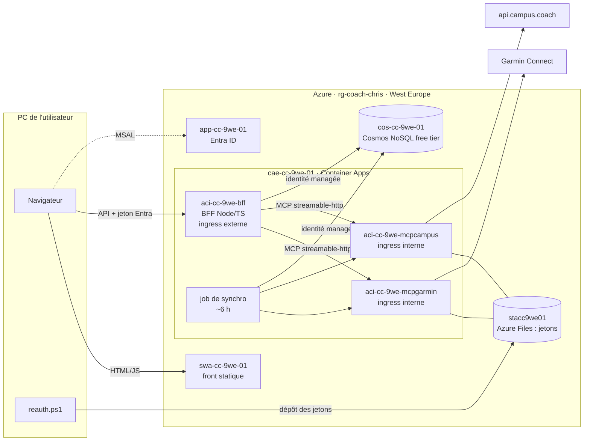

# CoachChris — Architecture V1

Statut : **brouillon pour relecture** (2026-10-07).
Sources : [requirements.txt](requirements.txt), [DECISIONS.md](DECISIONS.md) (D1 à D93), [AUDIT.md](AUDIT.md), [mobility-library.md](mobility-library.md).
Les numéros `Dxx` renvoient au journal des décisions. Ce document ne prend aucune décision nouvelle sans la signaler par ❓.

## 1. Vue d'ensemble



Principes :
- **Le BFF est le seul client MCP** (D2). Le navigateur ne parle qu'au BFF, jamais aux MCP ni à Garmin ou Campus.
- **On ne recrée pas la logique métier de Garmin ou de Campus et on ne simule pas leurs données.** L'app calcule seulement ce qui lui est propre : placement, écarts au plan, repères, mobilité, signaux. Une donnée absente reste absente et s'affiche « Donnée indisponible » (D11).
- **Cosmos est à la fois la base de l'app et le cache persistant** des données MCP normalisées (D4, D15).
- **Toute écriture externe** passe par un aperçu suivi d'une confirmation, et seuls les outils d'une liste blanche sont appelables (D13, D40).

## 2. Dépôt (monorepo npm workspaces, D5)

```
coach-chris/
├─ domain/            # TypeScript pur, sans E/S : règles et calculs, testés avec Vitest
├─ server/            # BFF : API REST, client MCP, Cosmos, synchro, job
├─ web/               # Vite + React + TS + TanStack Query + Recharts + Tailwind
├─ mcp/
│  ├─ garmin/         # Dockerfile autour de garmin_mcp (version épinglée)
│  └─ campus/         # source de campus-coach-mcp, repris ici (D96) + Dockerfile + outil d'écriture (§7)
├─ infra/             # Bicep (D93) + scripts d'amorçage
├─ reauth.ps1         # réauthentification Garmin/Campus (D34, D92, D117)
└─ .github/workflows/ # CI + déploiement (D32)
```

### 2.1 `domain/`, le cœur testable
Aucune dépendance réseau. Chaque règle produit son résultat **et sa justification** (le texte « Règle » affiché dans l'UI).

| Module | Contenu | Décisions |
|---|---|---|
| `plan/` | modèle de séance indépendant de la source (`source: campus \| claude \| manuel`), clé interne stable (date de semaine + index + nom) | D48, D63, 🔎 weekId instables |
| `placement/` | placement des séances sur les jours, vérification des 5 règles, déplacement et échange | D50, D60, D89 |
| `matching/` | rapprochement activité ↔ séance : `externalId` Campus d'abord, puis heuristiques (date, sport, durée…), puis validation manuelle | D36 |
| `deviation/` | écart étape par étape (`workout_step_index`), « après la séance », règles d'intensité | D66, D67 |
| `load/` | volume hebdomadaire par sport (marches exclues), repère 1,3 × moyenne sur 4 semaines | D56, D90 |
| `signals/` | signaux de l'écran Aujourd'hui (règle + texte, jamais de diagnostic) | D51 |
| `mobility/` | bibliothèque typée (30 exercices, 6 tests), statuts des zones, blocs de 2 semaines, créneau du jour, régularité | D74–D79, D91 |
| `wellness/` | tendance du poids (flèche vs pesée précédente, date affichée), VFC vs plage | D55, D88 |

### 2.2 `web/`
- Les 4 onglets V1 (Aujourd'hui, Calendrier, Mobilité, Données) et la sous-page Détail de séance (D71–D73), conformes aux maquettes validées : thème sombre par défaut, polices Barlow Semi Condensed, IBM Plex Sans et IBM Plex Mono, étiquettes de source (D57).
- Le **moteur du mannequin** (`mannequin.js` de la maquette) est porté en module TS dans `web/src/mannequin/` ; les poses restent des données (D80).
- Les données passent par TanStack Query : clé par écran et par semaine, invalidation après chaque écriture confirmée.
- Le thème est un jeu de jetons CSS pour le sombre et le clair, repris des maquettes.

### 2.3 `server/` (BFF)
- Node.js LTS, framework HTTP **Fastify** (D95), validation des entrées avec **zod**, types partagés avec `domain/`.
- Le client MCP utilise le SDK officiel `@modelcontextprotocol/sdk` en transport streamable-http, avec une **liste blanche d'outils par serveur** (§6).
- L'accès à Cosmos passe par `@azure/cosmos` et `DefaultAzureCredential` : identité managée sur Azure, `az login` en local (D28).
- Le **même binaire** sert l'API (`node server api`) et le job de synchro (`node server sync`).

## 3. Données (Cosmos NoSQL, free tier, D14/D15)

Une base `coachchris` avec un **débit partagé de 1000 RU/s** (le maximum gratuit) sert tous les conteneurs. Il n'y a qu'un utilisateur, donc les partitions servent surtout à borner les requêtes.

| Conteneur | Clé de partition | Documents | Notes |
|---|---|---|---|
| `cache` | `/pk` = `<type>#<AAAA-MM>` | activités, tours, sommeil, VFC, disponibilité, poids, Body Battery, stress (normalisés depuis Garmin) | synchro incrémentale ; ne contient que des données réelles, jamais estimées |
| `plan` | `/weekDate` | semaines et séances Campus **versionnées** à chaque régénération, détail des séances, allures de référence | archive D45/D46 ; une version n'est jamais écrasée |
| `library` | `/kind` | exercices de renforcement dédoublonnés (variantes, matériel, liens vidéo et miniatures, texte « à valider »), table exercice → muscles | D46, D47, audit §2 |
| `user` | `/kind` | placements par semaine, routines cochées, résultats des tests, blocs de mobilité, validations de rapprochement, préférences | données propres à l'app |
| `ops` | `/kind` | journal des synchros (10 dernières affichées), état des jetons, journal des écritures externes | TTL de 90 jours sur le journal |

Règles :
- Chaque document porte `source` (garmin, campus ou app), `fetchedAt` et un `schemaVersion`.
- Le cache sert les écrans immédiatement, puis la synchro le complète en arrière-plan : la reprise est rapide même après un démarrage à froid et les appels à Garmin restent limités (D15).
- Le « trou » d'une nuit absente est conservé comme absence (D84), sans interpolation.

## 4. API du BFF

Toutes les routes sont sous `/api`. Elles exigent un jeton Entra valide (§8), sauf en local.

| Route | Écran | Rôle |
|---|---|---|
| `GET /today` | Aujourd'hui | objectif, prochaine séance, forme et poids, volume et repère, semaine jour par jour, mobilité du jour, signaux |
| `GET /calendar/week?start=` · `GET /calendar/month?m=` | Calendrier | séances placées, activités rattachées ou hors plan, coches mobilité |
| `PUT /calendar/week/:start/placement` | Calendrier | déplacer ou échanger des séances ; la réponse contient les avertissements de règles |
| `GET /sessions/:key` | Détail de séance | prévu vs réalisé, intervalles, tours, zones FC, conseil |
| `GET /mobility` · `PUT /mobility/log/:date/:slot` | Mobilité | routines, priorités, régularité, tests, démonstrations ; cocher une routine (rattrapage jusqu'à J-3, D38) |
| `POST /mobility/tests` · `POST /mobility/blocks/:id/accept` | Mobilité | saisir les tests ; valider le bloc proposé (validation obligatoire, D78) |
| `GET /data/status` | Données | état par source, fraîcheur, journal (D81–D84) |
| `POST /sync?source=` | Données, bouton Actualiser | synchro à la demande |
| `POST /actions/preview` · `POST /actions/confirm` | Détail de séance, Prochaine séance | écritures externes (§7) |
| `GET /health` | — | sonde Container Apps |

## 5. Synchronisation (D35)

| Déclencheur | Portée |
|---|---|
| **Job quotidien** (Container Apps Job, cron en UTC, réglé sur **≈ 6 h heure de Paris**) | nuit (sommeil, VFC, disponibilité), activités de la veille et leurs tours, plan Campus de la semaine en cours et de la suivante (nouvelle version archivée si elle a changé), poids ; garde le jeton Campus vivant |
| Ouverture de l'app | rattrapage depuis le dernier `fetchedAt` |
| Bouton « Actualiser » | idem, pour une source donnée |

- Chaque passage écrit une ligne dans `ops` : origine, heure, durée et résultat par source (D83).
- **Erreurs** : un 401 ou un refus du refresh token passe la source en « Jeton expiré ». L'écran Données affiche alors la commande `.\reauth.ps1 -Source campus|garmin` (D82, D92). Les autres erreurs sont réessayées avec un délai croissant, et le message reste lisible.
- Le cron s'exprime en UTC : **heure UTC fixe** (D97), le job tourne donc à 6 h l'été et à 5 h l'hiver (heure de Paris).

## 6. Serveurs MCP

| | Garmin | Campus |
|---|---|---|
| Image | `garmin_mcp` épinglé, Python slim | `campus-coach-mcp` (code de l'utilisateur) |
| Transport | streamable-http, port interne | streamable-http, port 8001 |
| Ingress | **interne uniquement** en V1 (D27) | interne uniquement |
| Jetons | `/data/garmin` sur Azure Files (`GARMINTOKENS`) | `/data/campus/tokens.json` sur Azure Files (`CAMPUS_COACH_TOKEN_DIR`), session dédiée (D117) |
| Hôte HTTP | — | protection DNS rebinding active, nom interne admis par `CAMPUS_MCP_ALLOWED_HOSTS` (D121) |
| Outils autorisés | lecture : activités, tours, zones FC, sommeil, VFC, disponibilité, Body Battery, stress, poids, appareil ; écriture : création et planification de workout, nom, description, RPE et ressenti d'activité, suppression des seuls workouts « CC · » | les 9 outils de lecture + `complete_session` (§7, D125) |

La liste blanche est appliquée **deux fois** :
- côté MCP, par `GARMIN_ENABLED_TOOLS`, qui masque tout le reste dont les outils de nutrition et de suppression en masse ;
- côté BFF, par une table codée en dur.

Les MCP n'ont pas d'authentification HTTP propre. Ils restent donc joignables seulement depuis l'environnement Container Apps.

Les deux MCP **rafraîchissent eux-mêmes leurs jetons** et les réécrivent sur le partage. Le jeton Campus change à chaque rafraîchissement : un seul processus doit l'utiliser à la fois. Pour cela, `aci-cc-9we-mcpcampus` est limité à **1 réplique maximum**, et le job passe par ce même MCP au lieu d'ouvrir une seconde session.

## 7. Écritures externes (D13, D18, D39, D40)

Protocole en deux temps :
1. `POST /api/actions/preview` reçoit `{ type, … }` (`campus.complete`, `garmin.push`, `garmin.annotate`). Le BFF **relit la source** et construit les appels exacts. Il renvoie un **aperçu lisible** (champ par champ, avertissements) et un jeton d'action valable 5 min qui **contient** ces appels, signé HMAC-SHA256 avec une clé aléatoire propre au processus (D123).
2. `POST /api/actions/confirm` reçoit `{ token }`. Le BFF vérifie la signature, l'expiration et l'usage unique, appelle les outils MCP avec le drapeau d'écriture (D124), **contrôle chaque réponse** (les erreurs Garmin arrivent en texte), puis journalise dans `ops` (`action-log`, sans jeton) et relit la source concernée.

| Action | Outil | Particularités |
|---|---|---|
| **Valider une séance dans Campus** | nouvel outil `complete_session` dans `campus-coach-mcp` → `PUT /smart-training/session/{weekId}/{sessionIndex}/complete` | le corps est construit **uniquement à partir de l'activité Garmin** rattachée ; l'outil **relit le plan juste avant l'appel**, car les `weekId` changent, puis retrouve la séance par sa clé interne ; `_t` dépend du sport (❓ variantes route et PPG à confirmer à la première utilisation) |
| Envoyer une séance sur la montre | création et planification du workout Garmin | nom préfixé « CC · », note courte dans la description (D39) ; jamais automatique (D40) |
| Annoter une activité Garmin | nom, description, RPE, ressenti | seuls les champs modifiés partent ; Garmin stocke le RPE ×10 (`workout_rpe: 10` = 1/10, D127) |

## 8. Sécurité et authentification (D17, D28, D30)

- **Front** : Static Web Apps Free, contenu statique sans aucune donnée. MSAL se connecte avec l'inscription `app-cc-9we-01`, avec « affectation requise » : seul ton compte est autorisé.
- **BFF** : Easy Auth de Container Apps (fournisseur Entra) valide le jeton bearer. Le BFF vérifie en plus l'audience et l'identifiant objet de ton compte (défense en profondeur). Le CORS n'autorise que l'origine SWA.
- **Local** : pas d'authentification (D17) ; le drapeau `AUTH_DISABLED` est refusé au démarrage si `NODE_ENV=production`.
- **Secrets** : pas de Key Vault. L'accès à Cosmos passe par l'identité managée `mid-cc-9we-01` avec un rôle RBAC sur le plan de données. Les images GHCR sont publiques (D116) : aucun PAT. Il reste dans Container Apps :
  - la clé du compte de stockage, que le montage Azure Files de Container Apps exige.
  La clé de signature des jetons d'action est tirée au hasard au démarrage du BFF (D123) : rien à stocker.
- **Jetons Bearer** Garmin et Campus : jamais journalisés, jamais renvoyés au front.

## 9. Infrastructure Azure (Bicep, D93)

Deux fichiers (D118) :
- `infra/main.bicep` (portée **abonnement** : resource group et budget), rejoué à la main : `az deployment sub create -l westeurope -n cc-infra -p infra/main.bicepparam` ;
- `infra/app.bicep` (portée **resource group** : tout le reste, Cosmos compris via `infra/modules/cosmos.bicep`), déployé par `deploy.yml` à chaque push sur `main` : `az deployment group create -g rg-coach-chris -p infra/app.bicepparam -p imageTag=<sha>`.

Adresses : API `https://aci-cc-9we-bff.icyflower-b20a9c19.westeurope.azurecontainerapps.io`, front `https://salmon-field-0225c0803.3.azurestaticapps.net`.

| Ressource | Nom | Points clés |
|---|---|---|
| Log Analytics | `log-cc-9we-01` | rétention 30 j, **plafond d'ingestion journalier** pour protéger le budget |
| Environnement Container Apps | `cae-cc-9we-01` | consommation, scale to zero |
| BFF | `aci-cc-9we-bff` | ingress externe, Easy Auth, 0 à 1 réplique |
| MCP Garmin / Campus | `aci-cc-9we-mcpgarmin`, `aci-cc-9we-mcpcampus` | ingress interne, 0 à 1 réplique, volume Azure Files |
| Job de synchro | `job-cc-9we-sync` | image du BFF, `node server/src/sync-cli.ts`, cron `0 4 * * *` UTC |
| Cosmos | `cos-cc-9we-01` | `enableFreeTier: true` (**un seul par abonnement, à fixer à la création**), API NoSQL, rôle RBAC sur le plan de données pour l'identité managée et pour ton compte (dev local) |
| Stockage | `stacc9we01` | partage `tokens`, LRS |
| Identité managée | `mid-cc-9we-01` | utilisée par le BFF et le job |
| Static Web App | `swa-cc-9we-01` | Free |
| Budget | `bud-cc-9we-01` | **7 €/mois** sur tout l'abonnement, alertes e-mail à 50, 80 et 100 % (D105) |

Ce que Bicep ne fait pas bien est confié à `infra/bootstrap.ps1`, lancé une fois après `az login` :
- l'inscription d'application Entra `app-cc-9we-01` (redirect URIs local et SWA) et l'affectation de ton compte ;
- la fédération OIDC pour GitHub Actions (deux formes de sujet, D120).

Le dépôt des jetons sur Azure Files passe par `reauth.ps1 -Source garmin|campus` (D117).

### Coût estimé (à vérifier après un mois réel)
| Poste | Estimation |
|---|---|
| Container Apps (consommation, scale to zero) | ≈ 0 €, dans l'allocation gratuite mensuelle si l'usage reste personnel |
| Cosmos free tier (1000 RU/s, 25 Go) | 0 € |
| Azure Files (quelques Ko) + transactions | < 0,50 € |
| Log Analytics | 0 € sous l'allocation gratuite ; **principal risque**, d'où le plafond journalier |
| Static Web Apps Free, Entra ID | 0 € |
| **Total attendu** | **< 2 €/mois**, sous le budget de 7 € |

GHCR : images publiques (D116), donc sans limite de transfert ; elles ne contiennent ni secret ni donnée personnelle.

## 10. CI/CD (GitHub Actions, D32)

- `ci.yml` (pull request et push) : installation, lint, contrôle des types, tests Vitest (`domain/` en priorité), build du web.
- `deploy.yml` :
  - à chaque push : build des 3 images (BFF, MCP Garmin, MCP Campus) → GHCR, étiquetées par SHA (et `latest` sur `main`) ;
  - sur `main` seulement : `az deployment group create` de `infra/app.bicep` via OIDC (les Container Apps passent à l'image du SHA), puis build du front avec l'URL de l'API et déploiement sur SWA.
- Aucune clé Azure longue durée dans GitHub (OIDC).

## 11. Développement local (D1, D14, D17)

- Le BFF lance lui-même les deux MCP en **stdio** (`GARMIN_MCP_CMD`, `CAMPUS_MCP_CMD` dans `server/.env`, modèle `server/.env.example`) avec les jetons déjà présents sur le poste. Sur Azure, `GARMIN_MCP_URL` / `CAMPUS_MCP_URL` (streamable-http) les remplacent (D106).
- `npm run sync -w server` lance une synchro complète en ligne de commande (même code que le futur job).
- `npm run dev` lance le BFF sur `:3000` et Vite sur `:5173`, avec un proxy `/api`.
- Cosmos est le **vrai compte Azure** (D14), avec `az login` et RBAC : il faut donc qu'Azure soit activé avant de coder la persistance.
- **AVG** intercepte le HTTPS : `NODE_OPTIONS=--use-system-ca` pour Node, `REQUESTS_CA_BUNDLE` pour Azure CLI, `--system-certs` pour uv.

## 12. Jalons proposés

| # | Jalon | Livrable vérifiable |
|---|---|---|
| M0 | Socle | dépôt initialisé et poussé, workspaces, lint, CI verte |
| M1 | `domain/` | règles placement, écarts, repère, mobilité, rapprochement, couvertes par des tests (cas réels de l'audit : S1-3 du 04/10, semaine S2) |
| M2 | BFF en lecture, en local | `GET /today` et `/calendar` alimentés par les vrais MCP, cache Cosmos |
| M3 | Front | 4 onglets + Détail de séance sur l'API locale |
| M4 | Azure | Bicep + bootstrap, déploiement complet, Entra |
| M5 | Écritures | `complete_session` (Campus), envoi sur la montre, annotation ; aperçu et confirmation |
| M6 | Synchro et Données | job quotidien, journal, état des jetons, `reauth.ps1` |

L'activation d'Azure (paiement à l'usage, budget, Azure CLI) est nécessaire **avant M2**, à cause du Cosmos réel en dev.

## 13. Questions ouvertes (❓)

1. ~~Framework du BFF~~ → Fastify (D95).
2. ~~Emplacement de `campus-coach-mcp`~~ → `mcp/campus` (D96).
3. ~~Cron du job~~ → heure UTC fixe (D97).
4. Variantes `_t` du corps de validation Campus : route essayée avec `SmartRacingNoteForm` et vérifiée par relecture (D125) ; renforcement non pris en charge en V1.
5. ~~Échelle RPE Garmin~~ → stockée ×10 (D127).
6. ~~Certificat AVG et Node~~ → `NODE_OPTIONS=--use-system-ca`.
7. ~~Images GHCR privées ou publiques~~ → publiques (D116).
